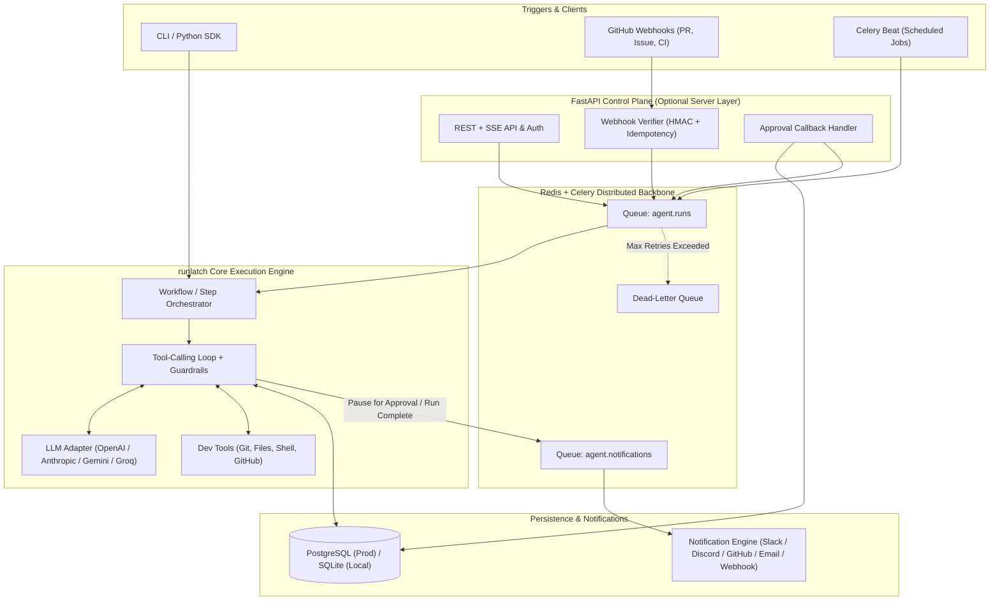

# `runlatch` — Durable, HITL-First Execution Runtime for Autonomous Developer Agents

> **Tagline:** *The MCP-native, event-driven Python runtime for autonomous developer workflows — zero-infra locally, production-hardened with pause/resume approvals in the cloud.*

---

## Executive Summary

`runlatch` is an open-source, modular Python **execution runtime and framework** for building, governing, and operating **autonomous developer workflows** — from interactive local CLI runs to event-driven background pipelines triggered by GitHub webhooks and schedules.

Rather than competing as "yet another LLM wrapper," `runlatch` focuses on the missing production layer for **software engineering automation**:

1. **Zero-Infra Core Runtime (`pip install runlatch`)**: Define typed tools with `@tool` **or plug in any MCP (Model Context Protocol) server**, compose multi-step workflows, enforce token/cost caps and risk tiers, and persist checkpoints locally via async SQLAlchemy + SQLite.
2. **Production Server & Live UI (`pip install "runlatch[server]"`)**: Scale the exact same workflow code into a resilient distributed runtime powered by **FastAPI + HTMX Run Inspector**, **PostgreSQL**, **Redis + Celery**, and a **Pluggable Notification Engine** (Slack, Discord, GitHub PR comments, Webhooks, Email).
3. **Stateless Human-in-the-Loop (HITL) Pause & Resume**: High-risk developer actions (`git push`, opening PRs, running migrations) automatically checkpoint conversation state **and git diff patches**, suspend the worker immediately, send a read-only confirmation link (immune to link-unfurler auto-approvals), and resume cleanly on *any* worker via fresh `git worktree` reconstruction.

---

## Start Here

- **[`START-HERE-ROADMAP.md`](START-HERE-ROADMAP.md)** — **Read this first before coding.** Strict modular architecture, import boundary rules (for AI-IDE maintainability), exact folder structure, and step-by-step vertical build order.

## Document Map

### Product & Market Strategy (`product/`)
| Document | Scope |
|---|---|
| [`product/01-vision-market-differentiation.md`](product/01-vision-market-differentiation.md) | Problem statement, 2026 competitor comparison (LangGraph, CrewAI, PydanticAI, MCP ecosystem, OpenHands), our runtime + MCP wedge, personas, and non-goals. |
| [`product/02-use-cases-and-workflows.md`](product/02-use-cases-and-workflows.md) | 5 flagship autonomous developer workflows (PR Review, CI Failure Triage, Issue-to-PR Patcher with stateless worktree HITL, Dependency Audit, Doc Drift Sync). |

### Architecture & Production Systems (`architecture/`)
| Document | Scope |
|---|---|
| [`architecture/03-tech-stack-and-tradeoffs.md`](architecture/03-tech-stack-and-tradeoffs.md) | Two-layer stack, unified async SQLAlchemy storage, Celery `NullPool` async safety, MCP integration, and honest architectural tradeoffs. |
| [`architecture/04-core-framework-design.md`](architecture/04-core-framework-design.md) | Core runtime design: `AgentProtocol` (BYO agent or built-in loop), `@tool` + `MCPToolkit`, `SEARCH/REPLACE` file editing, loop detection, `Workflow` engine, and stateless checkpoints. |
| [`architecture/05-production-runtime-celery-redis-notifications.md`](architecture/05-production-runtime-celery-redis-notifications.md) | Production async architecture: FastAPI control plane + HTMX Approval/Run Inspector UI, GitHub webhook idempotency, Celery + Redis queues, stateless git worktree resume, and Notification Dispatcher. |
| [`architecture/06-database-schema-and-api-spec.md`](architecture/06-database-schema-and-api-spec.md) | Unified SQLAlchemy 2.0 / PostgreSQL 16 schema (including `workspace_patch` + `workspace_meta` for stateless resume), REST API, HTMX confirmation page, and SSE streaming. |
| [`architecture/07-security-guardrails-and-observability.md`](architecture/07-security-guardrails-and-observability.md) | Honest security threat model: two-tier `CommandExecutor` (trusted subprocess vs. ephemeral Docker `--network=none`), strict allowlists (no raw `python`), secret redaction, budget caps, and OpenTelemetry. |

### Engineering Execution & Operations (`engineering/`)
| Document | Scope |
|---|---|
| [`engineering/08-repo-structure-and-dx.md`](engineering/08-repo-structure-and-dx.md) | Hexagonal modular repository layout, `pyproject.toml` extras, CLI design, HTMX Run Inspector UI, Docker Compose stack, and GitHub Actions CI/CD. |
| [`engineering/09-engineering-roadmap-and-tasks.md`](engineering/09-engineering-roadmap-and-tasks.md) | Complete dependency-ordered engineering backlog (`ENG-001` through `ENG-030`) with file targets and acceptance criteria. |
| [`engineering/10-testing-deployment-and-interview-playbook.md`](engineering/10-testing-deployment-and-interview-playbook.md) | Deterministic testing pyramid, production deployment checklist, scaling ceilings, and technical interview walkthrough guide. |

---

## High-Level System Architecture

---

## Quick Alignment Check Against Resume

| Resume Claim | Concrete Implementation in `runlatch` |
|---|---|
| **Modular Agentic Framework** | Clean, decoupled `Agent`, `ToolRegistry`, `LLMProvider`, `Workflow`, `CheckpointStore`, and `PolicyEngine` interfaces. |
| **Autonomous Developer Workflows** | Native Git, File, Shell, Test-Runner, and GitHub API toolkits + 5 ready-to-run workflow blueprints. |
| **Tool-Calling Orchestration** | Unified JSON-Schema tool compiler, bounded ReAct loop, parallel tool calls, schema-validated retry feedback, and loop detection. |
| **Extensible Multi-Step Task Execution** | Composable `Workflow` steps with durable checkpoints, state passing, conditional branching, and HITL pause/resume. |
| **Production-Grade Engineering** | Optional FastAPI + PostgreSQL + Celery + Redis async worker plane + multi-channel Notification Engine + Docker Compose. |
