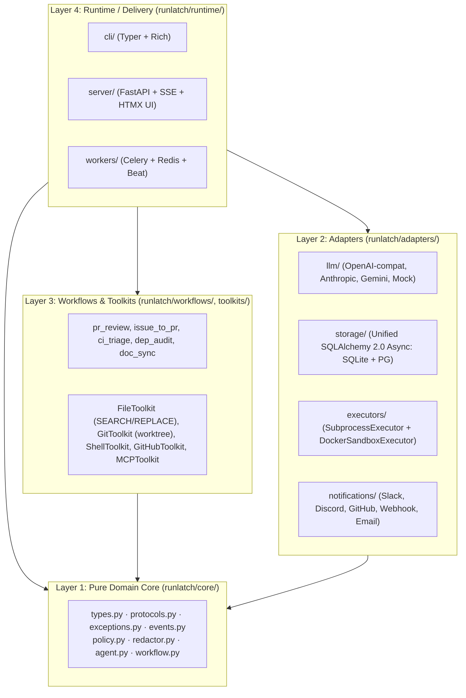

# `START-HERE-ROADMAP.md` — Modular Architecture & Step-by-Step Build Guide

> **Read this before writing line 1.** Because you're building solo with an AI IDE, raw coding speed is high — which means **bad module boundaries turn into unmaintainable spaghetti 10x faster**. This guide locks down the hexagonal architecture, strict import rules, and exact vertical build order so every module stays small, testable, and swappable.

---

## 1. Hexagonal Architecture & Strict Dependency Rules

`runlatch` is organized into **4 concentric layers**. Dependencies ONLY point inward — **never outward**.

### Hard Import Boundary Rules (Enforce These in Code Reviews & AI-IDE Rules!)

| Module | Allowed Imports | STRICTLY FORBIDDEN Imports |
|---|---|---|
| `runlatch/core/` | Python stdlib, `pydantic`, `runlatch.core.*` | `fastapi`, `celery`, `redis`, `sqlalchemy`, `httpx`, `mcp`, `typer`, `runlatch.runtime.*`, `runlatch.adapters.*` |
| `runlatch/tools/` | stdlib, `pydantic`, `runlatch.core.*` | `fastapi`, `celery`, `sqlalchemy`, `runlatch.runtime.*` |
| `runlatch/adapters/*` | stdlib, `runlatch.core.*`, + **only its own library** (e.g., `sqlalchemy` only in `adapters/storage/`) | Never import another adapter or `runlatch.runtime.*` |
| `runlatch/toolkits/*` | `runlatch.core.*`, `runlatch.tools.*`, `httpx` / `mcp` | `fastapi`, `celery`, `sqlalchemy`, `runlatch.runtime.*` |
| `runlatch/workflows/*` | `runlatch.core.*`, `runlatch.toolkits.*` | `fastapi`, `celery`, `sqlalchemy` (workflows are pure composition!) |
| `runlatch/runtime/*` | Wires `core` + `adapters` + `toolkits` + `workflows` together | Never put business logic, prompt loops, or SQL queries inside route handlers or Celery task wrappers — call `core` + `adapters`! |

**Why this makes your codebase maintainable:**
- You can test 100% of `core/` in `< 1 second` with zero Docker, zero Redis, and zero API keys.
- Swapping SQLite $\leftrightarrow$ PostgreSQL, Subprocess $\leftrightarrow$ Docker sandbox, OpenAI $\leftrightarrow$ Mock, or In-Process $\leftrightarrow$ Celery requires **zero changes** to `core/` or `workflows/`.

---

## 2. AI-IDE Guardrails (Copy Into `.cursorrules` / `AGENTS.md`)

Before generating your first file in your AI IDE, drop these 6 non-negotiable rules into your repo's AI rules file:

1. **Respect hexagonal imports:** Never import `fastapi`, `celery`, `redis`, `sqlalchemy`, or `httpx` inside `runlatch/core/`.
2. **One protocol per boundary:** Every external dependency (LLM, DB, Shell Executor, Notification Provider, Task Queue, Step Executor) MUST implement a `typing.Protocol` in `runlatch/core/protocols.py`.
3. **Celery async safety:** Every Celery task calling `asyncio.run(...)` MUST create a task-scoped SQLAlchemy async engine with `poolclass=NullPool` and call `await engine.dispose()` in `finally`.
4. **No state mutation on `GET`:** Approval links always open a read-only `GET /ui/approvals/{id}` page; state changes ONLY happen on `POST /api/v1/approvals/{id}/decision` inside a `SELECT ... FOR UPDATE` transaction.
5. **Stateless HITL checkpoints:** Before pausing a run that modifies files, run `git add -N .` (intent-to-add so brand-new untracked files aren't dropped!) before `git diff HEAD`, enforce a `512 KB` non-binary cap, and persist `workspace_patch` + `workspace_meta` (`repo_url`, `base_commit_sha`, `branch_name`) in `workflow_runs`.
6. **Tests before moving slices:** Never start Slice $N+1$ until `ruff check`, `mypy runlatch`, and `pytest` are green for Slice $N$.

---

## 3. Where to Start — Vertical Build Order (Dependency-Ordered Slices)

Ignore arbitrary day estimates — work through these **7 vertical slices in exact order**. Each slice produces a runnable, verifiable milestone.

### Slice 1 — Bootstrap, Core Protocols & ReAct Agent Loop
**Goal:** A working, typed, `$0`-testable tool-calling agent loop with budget caps and loop detection.
- **Create:**
  1. `pyproject.toml` (with `[mcp]`, `[server]`, `[observability]`, `[dev]` extras), `.gitignore`, `.env.example`, `LICENSE`
  2. `runlatch/core/types.py`, `runlatch/core/exceptions.py`, `runlatch/core/protocols.py`, `runlatch/config.py`
  3. `runlatch/tools/registry.py` (`@tool` Pydantic JSON Schema compiler + argument validation + self-correction error return + truncation)
  4. `runlatch/adapters/llm/pricing.py`, `mock.py`, `openai_compat.py` (with 1-line zero-cost presets: `OpenAICompatibleProvider.ollama()`, `.groq()`, `.github_models()` alongside OpenAI/OpenRouter)
  5. `runlatch/core/agent.py` (bounded ReAct loop, parallel read-only tool calls, `max_steps`/`max_tokens`/`max_cost_usd`, duplicate `(tool_name, args_hash)` loop detector)
- **Verify:** `pytest tests/unit/test_tools.py tests/unit/test_llm_openai.py tests/unit/test_agent_loop.py` + `ruff check` + `mypy runlatch`.

### Slice 2 — Safety Guardrails, Unified Async Storage & Multi-Step Workflows
**Goal:** Pause a workflow on a `RiskTier.EXTERNAL` tool, persist checkpoint + `workspace_patch` (using `git add -N .` + `git diff HEAD`, max `512 KB`, non-binary) to SQLite, destroy the in-memory agent, and resume cleanly.
- **Create:**
  1. `runlatch/core/redactor.py` (`SecretRedactor` regex + dynamic settings scrubbing)
  2. `runlatch/core/policy.py` (`PolicyEngine`: `ALLOW` / `REQUIRE_APPROVAL` / `DENY` + `runlatch.toml` rules)
  3. `runlatch/core/events.py` (`EventBus`)
  4. `runlatch/adapters/storage/models.py` + `sqlalchemy_store.py` (single async SQLAlchemy 2.0 store supporting both `sqlite+aiosqlite` and `postgresql+asyncpg`, including `workspace_patch` & `workspace_meta`)
  5. `runlatch/core/workflow.py` (`Workflow` + `Step` supporting built-in `Agent` OR any custom `StepExecutor` adapter, conditional steps, cross-step budget pooling)
- **Verify:** `tests/integration/test_hitl_resume.py` proves pause (including brand-new untracked files!) $\to$ fresh instance $\to$ resume (`approved=True` and `approved=False`), and `tests/security/test_redactor.py` passes.

### Slice 3 — Developer Toolkits, Local Shell Executor & MCP Bridge (Zero-Docker!)
**Goal:** Real repo inspection, reliable `SEARCH/REPLACE` editing, worktree git operations, local subprocess sandboxing, and plug-and-play MCP server governance — with zero Docker dependency so `v0.1.0` ships fast.
- **Create:**
  1. `runlatch/tools/sandbox.py` (`resolve_safe_path` traversal/symlink guard + denied globs)
  2. `runlatch/toolkits/filesystem.py` (`list_files`, `read_file`, `search_code`, **`edit_file` via `SEARCH/REPLACE` blocks**)
  3. `runlatch/toolkits/git.py` (`git_status`, `git_diff` with `git add -N .` + 512 KB cap, `git_log`, `git worktree` create/patch-apply/commit/push — `shell=False`)
  4. `runlatch/adapters/executors/subprocess_exec.py` (trusted local repos, strict allowlist, **no raw `python`/`bash`**) *(Note: `DockerSandboxExecutor` is deferred to Slice 6 alongside Docker Compose!)*
  5. `runlatch/toolkits/shell.py` + `runlatch/toolkits/github.py`
  6. `runlatch/toolkits/mcp.py` (`MCPToolkit` connecting stdio/Streamable-HTTP MCP servers and applying `PolicyEngine`, `RiskTier`, and `SecretRedactor` to every imported MCP tool!)
- **Verify:** `tests/security/test_sandbox.py` (path escapes, symlink escapes, shell metacharacters, rejected `python` binary) + `tests/unit/test_mcp_toolkit.py` pass.

### Slice 4 — Flagship Workflows (`pr-review`, `issue-to-pr`) & CLI + `--demo` Mode (**Ship `v0.1.0`!**)
**Goal:** A complete, zero-Docker, pip-installable local product you can push to GitHub and record a 15-second README GIF for at `$0`.
- **Create:**
  1. `runlatch/workflows/pr_review.py` + `runlatch/workflows/issue_to_pr.py`
  2. `runlatch/runtime/cli/main.py` (`runlatch init`, `run` with `--demo` flag backed by realistic `MockLLMProvider` traces, `runs list/inspect`, `approvals list`, `approve`, `reject`, `replay`)
  3. `examples/01_minimal_agent.py` through `examples/04_github_pr_reviewer.py`
  4. `.github/workflows/ci.yml`
- **Verify:** Run `runlatch run pr-review --demo` (at `$0`), test against Ollama/Groq/GitHub Models, verify `examples/02_mcp_governed_agent.py`, tag **`v0.1.0`**, and push to GitHub.

### Slice 5 — FastAPI Control Plane, Safe HTMX UI & PostgreSQL Migrations
**Goal:** Event-driven HTTP ingress, live SSE streaming, atomic approval locking, and a zero-build visual Run Inspector & Approval Confirmation UI.
- **Create:**
  1. `alembic.ini` + `alembic/versions/0001_initial_schema.py` (all 6 tables + `workspace_patch` / `workspace_meta`)
  2. `runlatch/runtime/server/app.py`, `auth.py` (Bearer + GitHub HMAC + signed approval URLs)
  3. `runlatch/runtime/server/routes/health.py`, `runs.py` (REST + Redis Pub/Sub SSE), `webhooks.py` (HMAC + Redis `SET NX`), `approvals.py` (`SELECT ... FOR UPDATE`), `metrics.py`
  4. `runlatch/runtime/server/routes/ui.py` + `templates/` (`GET /ui` Live Run Inspector + read-only `GET /ui/approvals/{id}` with `POST` Approve/Reject buttons)
- **Verify:** `tests/integration/test_webhooks.py` (HMAC + duplicate delivery ignored) + concurrency test (2 simultaneous `POST /approvals/{id}/decision` calls $\to$ one `200`, one `409`) + `GET /ui/approvals/{id}` never mutates DB.

### Slice 6 — Celery Workers, Docker Sandbox, Stateless Worktree Resume & Notifications (**Ship `v0.2.0`!**)
**Goal:** Full production distributed runtime running in 1 command via `docker compose up --build`.
- **Create:**
  1. `runlatch/runtime/workers/celery_app.py` (3 queues: `agent.runs`, `agent.notifications`, `agent.maintenance`, Beat schedule, `acks_late=True`, `worker_prefetch_multiplier=1`, `NullPool` async runner helper)
  2. `runlatch/runtime/workers/agent_tasks.py` (`run_workflow_task`, `resume_workflow_task` with stateless `git worktree` + `git apply --3way` patch reconstruction)
  3. `runlatch/runtime/workers/maintenance_tasks.py` (approval expiration sweeper + scheduled jobs)
  4. `runlatch/adapters/executors/docker_exec.py` (`DockerSandboxExecutor` with `--rm --network=none --cap-drop=ALL` for untrusted external PRs)
  5. `runlatch/adapters/notifications/` (`router.py`, `slack.py`, `github_comment.py`, `discord.py`, `webhook.py`, `email.py`) + `notification_tasks.py`
  6. `Dockerfile` + `docker-compose.yml`
- **Verify:** End-to-end Docker Compose test: simulated GitHub webhook $\to$ Celery worker pauses on `github_create_pr` $\to$ Slack/GitHub alert with `/ui/approvals/{id}` link $\to$ Approve in browser $\to$ Worker 2 reconstructs worktree from `workspace_patch` and finishes! Tag **`v0.2.0`**.

### Slice 7 — Remaining Workflows, Extra Providers & Open-Source Launch (**Ship `v1.0.0`!**)
**Goal:** Full feature completeness + high-impact OSS launch package.
- **Create:**
  1. `runlatch/workflows/ci_triage.py`, `dep_audit.py`, `doc_sync.py`
  2. `runlatch/adapters/llm/anthropic.py` + `gemini.py`
  3. OpenTelemetry spans (`observability` extra)
  4. Recorded real-world trace (`examples/traces/`) + 15-second GIF of the HTMX Live Run Inspector & Approval flow in `README.md` + `.github/workflows/release.yml` (PyPI publish).
- **Verify:** Full CI matrix green on Python 3.11 & 3.12, zero mypy/ruff errors, PyPI package installs cleanly (`pip install runlatch` and `pip install "runlatch[mcp,server]"`).
