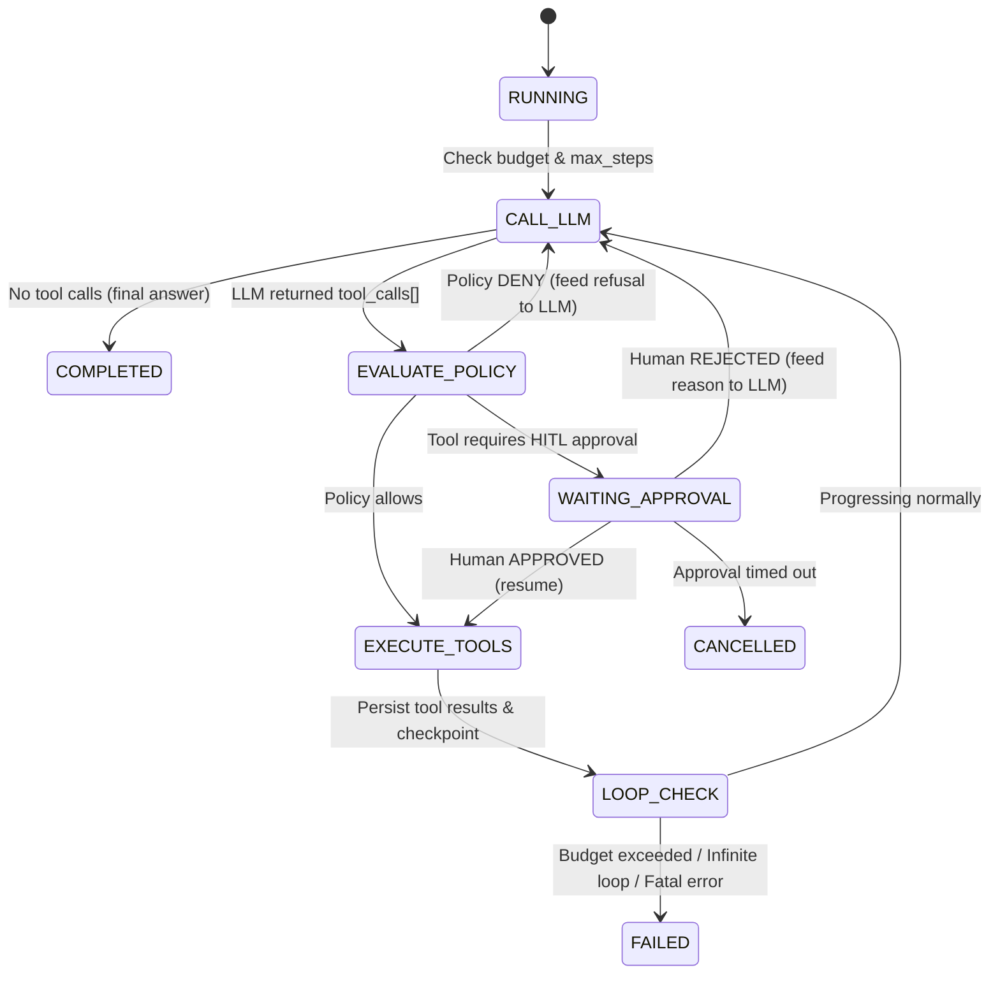

# 04 — Core Framework Design (Python SDK)

This document specifies the internal architecture of the `runlatch` Python package (`Layer 1`). Every module is designed to be **boring, composable, strictly typed, and testable without live API keys**.

---

## 1. Core Domain Primitives

`runlatch` consists of 6 clean building blocks:

```
┌──────────────────────────────────────────────────────────┐
│                     Workflow Engine                      │
│   (Multi-step DAG / Sequential pipeline + State handoff) │
└───────────────────────────┬──────────────────────────────┘
                            │ invokes
                            ▼
┌──────────────────────────────────────────────────────────┐
│                      Agent Runtime                       │
│   (ReAct Tool-Calling Loop + Budget + Loop Detector)     │
└──────┬────────────────────┬────────────────────┬─────────┘
       │                    │                    │
       ▼                    ▼                    ▼
┌─────────────┐     ┌──────────────┐     ┌───────────────┐
│ LLMProvider │     │ ToolRegistry │     │ PolicyEngine  │
│ (Unified    │     │ (@tool +     │     │ (Risk Tiers + │
│  Adapters)  │     │ JSON Schema) │     │  HITL Pause)  │
└─────────────┘     └──────────────┘     └───────────────┘
                            │
                            ▼
                  ┌──────────────────┐
                  │ CheckpointStore  │
                  │ (SQLite / PG)    │
                  └──────────────────┘
```

---

## 2. Tool System (`runlatch/tools/`)

### 2.1 `@tool` Decorator & Schema Compilation
Any sync or async Python function with type hints and a docstring becomes an LLM-callable tool:

```python
from enum import StrEnum
from runlatch import tool, RiskTier

@tool(risk=RiskTier.READ, timeout_s=15)
async def read_file(path: str, start_line: int = 1, end_line: int = 200) -> str:
    """Read lines from a file inside the repository workspace."""
    ...

@tool(risk=RiskTier.EXTERNAL, requires_approval=True)
async def github_create_pr(title: str, body: str, head: str, base: str = "main") -> dict:
    """Open a GitHub Pull Request from the specified branch."""
    ...
```

### 2.2 Internal Mechanics
1. **Introspection:** Uses `inspect.signature` + Pydantic `create_model` to automatically build a strict JSON Schema (`parameters`) from Python type annotations and default values.
2. **Pre-Execution Validation:** Before invoking the underlying Python function, raw JSON arguments from the LLM are validated through the generated Pydantic model.
   - If the LLM hallucinates a wrong type or missing field, `runlatch` does **NOT** crash — it returns a structured validation error message back to the LLM as a tool result so the model can self-correct on the next turn!
3. **Output Truncation:** Tool outputs exceeding `max_output_chars` (default: `16,000` chars) are head+tail truncated with a clear marker (`... [truncated 42,100 chars] ...`) so one huge log file never blows out the LLM context window.
4. **Risk Tiers:**
   - `RiskTier.READ`: Read-only workspace / API inspection (auto-allowed by default).
   - `RiskTier.WRITE`: Mutates local files or git branches.
   - `RiskTier.EXEC`: Executes shell commands / test suites.
   - `RiskTier.EXTERNAL`: Mutates external systems (`git push`, open PR, merge, deploy).

### 2.3 Built-In Developer Toolkits & MCP Bridge (`runlatch/toolkits/`)
- **`FileToolkit(workspace_root)`:** `list_files`, `read_file`, `search_code`, and **`edit_file` (deterministic `SEARCH/REPLACE` block editor)** with exact match + whitespace-normalized fallback and atomic write. *(LLMs frequently hallucinate unified diff hunk line counts; `SEARCH/REPLACE` blocks have dramatically higher reliability, while `git diff` generates clean unified diffs for review and checkpoints.)*
- **`GitToolkit(workspace_root)`:** `git_status`, `git_diff`, `git_log`, `git_create_branch`, `git_commit`, `git_push` (`shell=False` + ephemeral `git worktree` support).
- **`ShellToolkit(executor, allowed_prefixes)`:** Plugs into a `CommandExecutor` protocol (`SubprocessExecutor` for trusted local repos, `DockerSandboxExecutor` with `--network=none` for untrusted PRs).
- **`GitHubToolkit(token, repo)`:** `get_pr_diff`, `get_issue`, `post_comment`, `create_pr`, `get_workflow_logs`.
- **`MCPToolkit(server_params, default_risk=RiskTier.EXTERNAL, tool_risk_overrides={...})`:** Connects to any Model Context Protocol (MCP) server (`stdio` or `SSE`), discovers tools dynamically, and wraps every remote tool with `PolicyEngine`, `SecretRedactor`, budget caps, and HITL approvals.

---

## 3. Unified LLM Provider Layer (`runlatch/llm/`)

All providers implement a single normalized `LLMProvider` protocol:

```python
class LLMResponse(BaseModel):
    content: str | None
    tool_calls: list[ToolCall] = []
    input_tokens: int
    output_tokens: int
    cost_usd: float
    model: str
    latency_ms: int
    finish_reason: Literal["stop", "tool_calls", "length", "error"]

class LLMProvider(Protocol):
    async def complete(
        self,
        messages: list[Message],
        tools: list[ToolSpec] | None = None,
        temperature: float = 0.0,
        max_tokens: int = 2048,
    ) -> LLMResponse: ...
```

### Supported Providers
1. **`OpenAICompatibleProvider`**: Speaks OpenAI Chat Completions + tool calling via `httpx`. Ships 1-line zero-cost presets (`OpenAICompatibleProvider.ollama()`, `.groq()`, `.github_models()`) alongside OpenAI, Azure OpenAI, and OpenRouter via `base_url`.
2. **`AnthropicProvider`**: Speaks Anthropic Messages API (`tool_use` / `tool_result` blocks) with exact token/cost pricing table.
3. **`GeminiProvider`**: Speaks Google Gemini REST `generateContent` with `functionDeclarations` / `functionCall`.
4. **`MockLLMProvider`** (built-in for tests!): Deterministic scripted response queue so every agent, workflow, guardrail, and HITL pause/resume path can be unit-tested in milliseconds with `$0` API spend.

### Resilience Built into the Adapter
- Automatic retry with exponential backoff + jitter on HTTP `429`, `500`, `502`, `503`, `529`.
- Respects `Retry-After` headers.
- Central model pricing table (`runlatch/llm/pricing.py`) calculating exact `cost_usd` per call.

---

## 4. Tool-Calling Orchestration Loop (`runlatch/agent.py`)

This is the heart of `runlatch`. Each call to `agent.run(...)` executes a **bounded, checkpointed state machine**:



### Key Orchestration Features
1. **Parallel Tool Execution:** When the LLM returns multiple read-only tool calls in one turn (e.g., reading 4 files simultaneously), `runlatch` runs them concurrently via `asyncio.gather()` while preserving deterministic ordering in the message transcript.
2. **Loop Detection Engine:** Tracks a rolling window of `(tool_name, sha256(canonical_args))` fingerprints.
   - 2 identical calls $\to$ injects a system warning: *"You already ran this exact tool with identical arguments. Try a different approach or summarize what is blocked."*
   - 3 identical calls $\to$ halts run with `LoopDetectedError` (saves tokens and prevents runaway bills).
3. **Budget Guardrails:** Before *every* LLM call, verifies:
   - `step_count < config.max_steps` (default: 15)
   - `total_tokens < config.max_tokens` (default: 100,000)
   - `total_cost_usd < config.max_cost_usd` (default: `$0.50`)
4. **Stateless Pause & Resume Semantics:**
   - When `PolicyEngine` returns `REQUIRE_APPROVAL`, the loop **immediately saves a `RunCheckpoint`** (messages, pending `tool_call_id`, accumulated tokens/cost, workflow step index, **plus `workspace_patch` captured via `git add -N .` + `git diff HEAD` (max `512 KB`, non-binary) and `workspace_meta` (`repo_url`, `base_commit_sha`, `branch_name`)**) and returns `RunResult(status=RunStatus.WAITING_APPROVAL, approval_id=...)`.
   - Later, on *any* worker, `agent.resume(run_id, approved=True, reviewer="prathamesh")` reloads the checkpoint, reconstructs the repo + patch in a fresh `git worktree` if `workspace_patch` is present, executes the approved tool call, and seamlessly continues the loop!

---

## 5. Multi-Step Workflow Engine (`runlatch/workflow.py`)

Complex developer tasks shouldn't be stuffed into a single giant prompt with 30 tools. `Workflow` composes specialized, single-responsibility steps with typed state handoff:

```python
from runlatch import Workflow, Step, Agent

workflow = (
    Workflow(name="issue-to-pr", max_cost_usd=0.50)
    .add_step(Step(name="plan", agent=planner_agent))
    .add_step(Step(name="implement", agent=coder_agent))
    .add_step(
        Step(
            name="publish",
            agent=publisher_agent,
            condition=lambda ctx: ctx.get("tests_passed") is True,
        )
    )
)

result = await workflow.run(initial_input={"issue_number": 108})
```

### Workflow Capabilities
- **Bring-Your-Own-Agent (`StepExecutor` Protocol):** Any `Step` accepts either the built-in `Agent` OR any custom async `StepExecutor` adapter (e.g., wrapping PydanticAI or a deterministic Python function), inheriting `runlatch`'s checkpointing, budgets, and event streaming.
- **Shared Typed Context (`WorkflowContext`):** JSON-serializable key-value store passed across steps and persisted in `CheckpointStore` after every step boundary.
- **Conditional Branching:** Optional `condition(ctx) -> bool` predicate per step (e.g., skip PR creation if tests failed or no doc drift was detected).
- **Step-Level Retries & Fallback:** Individual steps can declare `retries=2` or a fallback step (e.g., post a diagnostic comment if auto-fix fails).
- **Cross-Step Budget Pooling:** The workflow's `max_cost_usd` applies globally across all child agents so total spend is strictly bounded.
- **Event Hooks (`EventBus`):** Emits structured lifecycle events (`run.started`, `step.started`, `tool.called`, `tool.completed`, `approval.requested`, `run.completed`, `run.failed`) consumed by CLI Rich UI, Redis Pub/Sub SSE streaming, and the Notification Engine.
