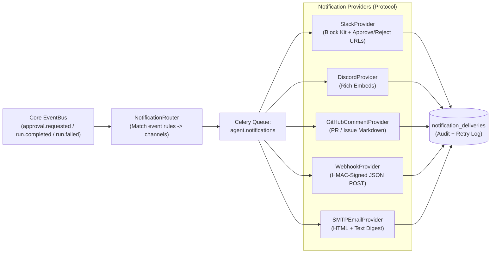

# 05 — Production Runtime: FastAPI, Celery, Redis & Notification Engine

This document details **Layer 2 (`runlatch[server]`)** — how the same core Python agents run reliably in production as an event-driven, fault-tolerant distributed platform.

---

## 1. Why Distributed Async Infrastructure Is Essential Here

When `runlatch` moves from a developer's laptop into a team environment triggered by GitHub webhooks or schedules, four production failure modes appear immediately:

1. **Webhook Timeouts:** GitHub cancels webhook deliveries after **10 seconds**. A multi-step agent workflow takes **30–300 seconds**.
2. **Duplicate Events:** GitHub retries webhooks on transient network hiccups; without idempotency keys, the same PR gets reviewed twice.
3. **Worker Starvation & Crashes:** If a worker executes both long LLM tool loops and short notification dispatches on the same queue, slow tasks block urgent approval alerts; if a worker OOMs, in-memory state disappears.
4. **Human Latency (HITL):** A human developer might take 4 hours to approve a `git_push` or `create_pr` action. Holding a Python process or thread open for 4 hours wastes memory and breaks across deploys.

Our architecture solves all four cleanly using **FastAPI + Redis + Celery + PostgreSQL**.

---

## 2. FastAPI Control Plane (`runlatch/server/`)

The FastAPI service is strictly a **stateless, non-blocking ingress and control plane**. It never runs LLM loops inside HTTP request handlers.

### Responsibilities
1. **GitHub Webhook Receiver (`POST /api/v1/webhooks/github`):**
   - Verifies `X-Hub-Signature-256` using constant-time HMAC-SHA256 (`hmac.compare_digest`) against `GITHUB_WEBHOOK_SECRET`.
   - Checks `X-GitHub-Delivery` UUID in Redis (`SET webhook:gh:<delivery_id> 1 NX EX 86400`). If already seen, returns `200 OK (duplicate_ignored)`.
   - Persists raw event metadata to `webhook_events`, matches configured trigger rules (e.g., `pull_request.opened` $\to$ `pr-review`), creates a `workflow_runs` row with status `QUEUED`, and enqueues the Celery task.
   - Returns `202 Accepted` with `run_id` in **< 50ms**.
2. **REST Management API:** Trigger workflows manually, inspect step-by-step tool logs, query cost analytics, cancel running workflows, and replay historical runs.
3. **Safe Approval Endpoints & HTMX Confirmation UI:**
   - `GET /ui/approvals/{approval_id}?sig=...&exp=...`: **Read-only** HTML confirmation page showing the git diff preview, test summary, tool arguments, and cost. **Never mutates state on `GET`**, preventing Slack link-unfurlers and corporate email security scanners from auto-approving actions.
   - `POST /api/v1/approvals/{approval_id}/decision`: Submitted by the confirmation page button, Slack interactive payload, or CLI. Validates signed HMAC token or Bearer key, acquires a Postgres `SELECT ... FOR UPDATE` lock (so concurrent clicks cannot double-resume), transitions status `WAITING_APPROVAL` $\to$ `RESUMING`, and dispatches `resume_workflow_task.delay(run_id, approval_id)`.
4. **Live Run Inspector UI (`/ui`) & SSE Streaming (`GET /api/v1/runs/{run_id}/stream`):**
   - Subscribes to Redis Pub/Sub channel `runlatch:run:{run_id}:events` and streams step/tool/token events over **Server-Sent Events (SSE)** to the CLI or the zero-build Jinja2 + HTMX Live Run Inspector.

---

## 3. Celery + Redis Queue Topology (`runlatch/workers/`)

### 3.1 Dedicated Queue Isolation

We explicitly separate workloads into **3 queues** so heavy agent runs never delay alerts or webhook ingestion:

| Queue Name | Worker Pool / Concurrency | Purpose | Time Limits (`soft` / `hard`) | Retry Policy |
|---|---|---|---|---|
| `agent.runs` | `prefork` (concurrency = 4–8) | Executes `run_workflow_task` and `resume_workflow_task` | `540s` / `600s` | `max_retries=2`, backoff on LLM 429/5xx only |
| `agent.notifications` | `gevent` or `threads` (concurrency = 16) | Dispatches Slack, Discord, Email, GitHub comments, and custom webhooks | `20s` / `30s` | `max_retries=5`, exponential backoff (`10s, 30s, 90s, 270s, 810s`) |
| `agent.maintenance` | `prefork` (concurrency = 2) | Celery Beat scheduled workflows (`dep-audit`), approval expiration sweeper, stale lock cleanup | `180s` / `240s` | `max_retries=1` |

### 3.2 Production Celery Reliability Settings
- **`task_acks_late = True`**: A task is only acknowledged *after* execution finishes (or checkpoints cleanly). If a worker container is killed mid-run, Redis redelivers the task to another healthy worker.
- **`task_reject_on_worker_lost = True`**: Ensures sudden SIGKILL/OOM causes requeue rather than silent task drop.
- **`worker_prefetch_multiplier = 1`**: Prevents one worker from greedily hoarding 4 long-running agent jobs while sibling workers sit idle.
- **Async Event-Loop Safety (`NullPool`):** Inside `prefork` workers, each task runs `asyncio.run(...)` with a **task-scoped SQLAlchemy async engine (`poolclass=NullPool`)** disposed in `finally`, preventing `asyncpg` `Future attached to a different loop` crashes across sequential tasks.
- **Stateless Git Worktree Reconstruction:** On `resume_workflow_task`, *any* worker can resume a paused `issue-to-pr` run by cloning/fetching `workspace_meta.base_commit_sha` into a fresh `git worktree` and applying the checkpointed `workspace_patch` from Postgres — zero reliance on Worker A's ephemeral disk.
- **Dead-Letter Queue (DLQ) Handling**: When a task exhausts all retries, Celery's `on_failure` signal handler persists the failure payload + traceback into `workflow_runs` / `notification_deliveries` (`status = DEAD_LETTER`) and fires an ops alert.

### 3.3 Redis Multi-Role Design (Reusing One Dependency)

| Redis Key Pattern | Data Type | TTL | Purpose |
|---|---|---|---|
| `celery:*` | Lists / Hashes | Managed | Celery broker & result backend |
| `runlatch:idem:webhook:{delivery_id}` | String (`1`) | 24h | Webhook deduplication (`SET NX EX`) |
| `runlatch:lock:repo:{owner}/{repo}` | String (owner token) | 10m (renewed) | Distributed mutex preventing concurrent git mutations on the same workspace |
| `runlatch:rate:llm:{provider}` | Sliding counter | 60s | Optional cross-worker RPM throttling |
| `runlatch:run:{run_id}:events` | Pub/Sub Channel | Ephemeral | Real-time event stream from Celery worker $\to$ FastAPI SSE |

---

## 4. Pluggable Notification Engine (`runlatch/notifications/`)

Autonomous background agents are useless if humans don't know when they finish, fail, or need approval.

### 4.1 Architecture



### 4.2 Provider Protocol
```python
class NotificationEvent(BaseModel):
    event_id: UUID
    event_type: Literal[
        "approval.requested",
        "approval.expired",
        "run.completed",
        "run.failed",
        "budget.exceeded",
    ]
    run_id: UUID
    workflow_name: str
    title: str
    summary: str
    metadata: dict[str, Any] = {}
    action_urls: dict[str, str] = {}  # {"approve": "...", "reject": "..."}

class NotificationProvider(Protocol):
    name: str
    async def send(self, event: NotificationEvent, target: str) -> DeliveryReceipt: ...
```

### 4.3 Safe Interactive Approval Notifications (End-to-End Flow)
When `PolicyEngine` pauses a run for an `EXTERNAL` tool call (e.g., `github_create_pr`):
1. Worker runs `git add -N .` (so new untracked files aren't dropped!) before saving `workspace_patch` (`git diff HEAD`, max `512 KB`, non-binary) + `workspace_meta` to Postgres before pausing.
2. Server generates a short-lived HMAC-signed **review URL** (valid for `approval_ttl_minutes`, default 60m):
   - `GET /ui/approvals/{id}?sig=...&exp=...` *(read-only confirmation page — immune to link-unfurler or email-scanner `GET` prefetches!)*
   - Clicking **Approve** or **Reject** on that page submits `POST /api/v1/approvals/{id}/decision` (Slack Block Kit interactivity also submits `POST` directly).
3. Notification task dispatches to configured channels (e.g., Slack `#dev-approvals` + GitHub Issue comment) with:
   - Workflow name & trigger (e.g., `issue-to-pr` on `repo#108`)
   - Exact tool & sanitized arguments (`github_create_pr(head="runlatch/issue-108", base="main")`)
   - Diff summary (`3 files changed, +42 -11`) & test status (`14 passed`)
   - Total tokens & cost so far (`$0.07`)
   - Signed review link + CLI equivalent (`runlatch approve <approval_id>`).
4. **Expiration Sweeper (Celery Beat, every 5 minutes):**
   - Queries `approval_requests WHERE status = 'PENDING' AND expires_at < NOW()`.
   - Marks expired approvals `EXPIRED`, transitions their runs to `CANCELLED`, and emits `approval.expired`.

---

## 5. Graceful Crash Recovery & Idempotency Guarantees

| Failure Scenario | How `runlatch` Survives It |
|---|---|
| **Worker crashes mid-workflow** | Every completed step and tool call is already committed to Postgres. `task_acks_late` redelivers the job; the worker loads the latest checkpoint and resumes from the next step instead of restarting from scratch. |
| **LLM provider returns HTTP 429 / 503** | Adapter retries with exponential backoff; if still failing, Celery retries the task after cooldown without losing prior completed steps. |
| **Slack / Email outage during alert** | Notification delivery runs on isolated `agent.notifications` queue with 5 retries and full `notification_deliveries` audit trail — never fails or rolls back the agent run itself. |
| **Duplicate GitHub webhook** | Rejected immediately at FastAPI ingress via Redis `NX` idempotency key (`X-GitHub-Delivery`). |
| **Two humans click Approve at once** | Postgres `SELECT ... FOR UPDATE` row lock ensures exactly one `resume_workflow_task` is enqueued; second click gets `409 Conflict (already_decided)`. |
