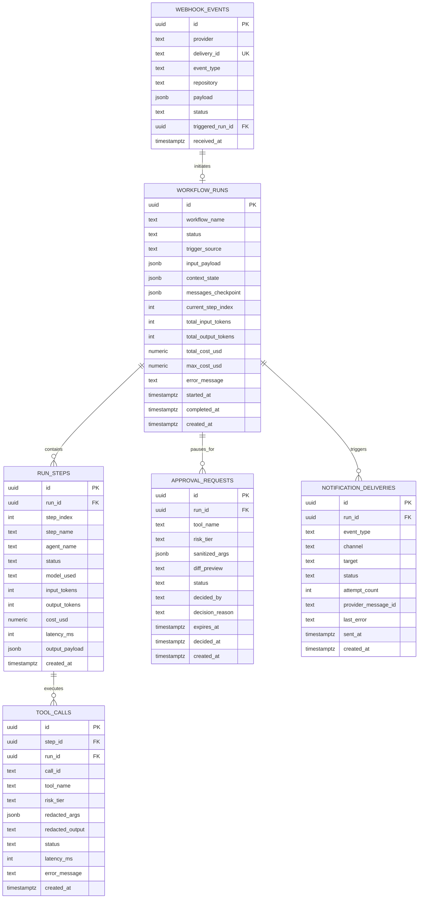

# 06 — Database Schema & API Specification

This document defines the exact relational data model (supporting both **SQLite** in Layer 1 local mode and **PostgreSQL 16** in Layer 2 production mode via SQLAlchemy 2.0) and the **FastAPI REST + SSE** contract.

---

## 1. Entity-Relationship Diagram



---

## 2. Authoritative PostgreSQL DDL (`migrations/0001_initial.sql`)

```sql
CREATE EXTENSION IF NOT EXISTS "pgcrypto";

-- 1. Core workflow execution record & durable checkpoint
CREATE TABLE workflow_runs (
    id                  UUID PRIMARY KEY DEFAULT gen_random_uuid(),
    workflow_name       TEXT NOT NULL,
    status              TEXT NOT NULL CHECK (status IN (
                            'QUEUED', 'RUNNING', 'WAITING_APPROVAL',
                            'RESUMING', 'COMPLETED', 'FAILED', 'CANCELLED'
                        )),
    trigger_source      TEXT NOT NULL CHECK (trigger_source IN ('cli', 'api', 'github_webhook', 'schedule')),
    repository          TEXT,
    input_payload       JSONB NOT NULL DEFAULT '{}'::jsonb,
    context_state       JSONB NOT NULL DEFAULT '{}'::jsonb,
    messages_checkpoint JSONB NOT NULL DEFAULT '[]'::jsonb,
    pending_tool_call   JSONB,
    workspace_meta      JSONB,
    workspace_patch     TEXT,
    current_step_index  INTEGER NOT NULL DEFAULT 0,
    total_input_tokens  INTEGER NOT NULL DEFAULT 0,
    total_output_tokens INTEGER NOT NULL DEFAULT 0,
    total_cost_usd      NUMERIC(10, 6) NOT NULL DEFAULT 0.000000,
    max_cost_usd        NUMERIC(10, 6) NOT NULL DEFAULT 0.500000,
    celery_task_id      TEXT,
    error_message       TEXT,
    started_at          TIMESTAMPTZ,
    completed_at        TIMESTAMPTZ,
    created_at          TIMESTAMPTZ NOT NULL DEFAULT now(),
    updated_at          TIMESTAMPTZ NOT NULL DEFAULT now()
);

CREATE INDEX idx_workflow_runs_status_created ON workflow_runs (status, created_at DESC);
CREATE INDEX idx_workflow_runs_name_created ON workflow_runs (workflow_name, created_at DESC);

-- 2. Individual step executions within a workflow run
CREATE TABLE run_steps (
    id                  UUID PRIMARY KEY DEFAULT gen_random_uuid(),
    run_id              UUID NOT NULL REFERENCES workflow_runs(id) ON DELETE CASCADE,
    step_index          INTEGER NOT NULL,
    step_name           TEXT NOT NULL,
    agent_name          TEXT NOT NULL,
    status              TEXT NOT NULL CHECK (status IN ('RUNNING', 'COMPLETED', 'SKIPPED', 'FAILED', 'PAUSED')),
    model_used          TEXT,
    input_tokens        INTEGER NOT NULL DEFAULT 0,
    output_tokens       INTEGER NOT NULL DEFAULT 0,
    cost_usd            NUMERIC(10, 6) NOT NULL DEFAULT 0.000000,
    latency_ms          INTEGER NOT NULL DEFAULT 0,
    output_payload      JSONB,
    error_message       TEXT,
    created_at          TIMESTAMPTZ NOT NULL DEFAULT now()
);

CREATE INDEX idx_run_steps_run_id ON run_steps (run_id, step_index);

-- 3. Immutable audit log of every tool invocation (secrets already redacted)
CREATE TABLE tool_calls (
    id                  UUID PRIMARY KEY DEFAULT gen_random_uuid(),
    step_id             UUID NOT NULL REFERENCES run_steps(id) ON DELETE CASCADE,
    run_id              UUID NOT NULL REFERENCES workflow_runs(id) ON DELETE CASCADE,
    call_id             TEXT NOT NULL,
    tool_name           TEXT NOT NULL,
    risk_tier           TEXT NOT NULL CHECK (risk_tier IN ('READ', 'WRITE', 'EXEC', 'EXTERNAL')),
    redacted_args       JSONB NOT NULL DEFAULT '{}'::jsonb,
    redacted_output     TEXT,
    status              TEXT NOT NULL CHECK (status IN (
                            'ALLOWED', 'DENIED', 'WAITING_APPROVAL', 'SUCCEEDED', 'FAILED', 'TIMED_OUT'
                        )),
    latency_ms          INTEGER NOT NULL DEFAULT 0,
    error_message       TEXT,
    created_at          TIMESTAMPTZ NOT NULL DEFAULT now()
);

CREATE INDEX idx_tool_calls_run_id ON tool_calls (run_id, created_at);

-- 4. Human-in-the-Loop approval gate records
CREATE TABLE approval_requests (
    id                  UUID PRIMARY KEY DEFAULT gen_random_uuid(),
    run_id              UUID NOT NULL REFERENCES workflow_runs(id) ON DELETE CASCADE,
    tool_call_id        UUID REFERENCES tool_calls(id) ON DELETE SET NULL,
    tool_name           TEXT NOT NULL,
    risk_tier           TEXT NOT NULL,
    sanitized_args      JSONB NOT NULL DEFAULT '{}'::jsonb,
    diff_preview        TEXT,
    status              TEXT NOT NULL DEFAULT 'PENDING' CHECK (status IN ('PENDING', 'APPROVED', 'REJECTED', 'EXPIRED')),
    decided_by          TEXT,
    decision_reason     TEXT,
    expires_at          TIMESTAMPTZ NOT NULL,
    decided_at          TIMESTAMPTZ,
    created_at          TIMESTAMPTZ NOT NULL DEFAULT now()
);

CREATE INDEX idx_approvals_pending ON approval_requests (status, expires_at) WHERE status = 'PENDING';

-- 5. Async notification delivery audit trail
CREATE TABLE notification_deliveries (
    id                  UUID PRIMARY KEY DEFAULT gen_random_uuid(),
    run_id              UUID REFERENCES workflow_runs(id) ON DELETE SET NULL,
    event_type          TEXT NOT NULL,
    channel             TEXT NOT NULL CHECK (channel IN ('slack', 'discord', 'github', 'email', 'webhook')),
    target              TEXT NOT NULL,
    status              TEXT NOT NULL DEFAULT 'PENDING' CHECK (status IN ('PENDING', 'SENT', 'FAILED', 'DEAD_LETTER')),
    attempt_count       INTEGER NOT NULL DEFAULT 0,
    provider_message_id TEXT,
    last_error          TEXT,
    sent_at             TIMESTAMPTZ,
    created_at          TIMESTAMPTZ NOT NULL DEFAULT now()
);

CREATE INDEX idx_notifications_run_id ON notification_deliveries (run_id, created_at DESC);

-- 6. Webhook ingestion log & idempotency ledger
CREATE TABLE webhook_events (
    id                  UUID PRIMARY KEY DEFAULT gen_random_uuid(),
    provider            TEXT NOT NULL,
    delivery_id         TEXT NOT NULL UNIQUE,
    event_type          TEXT NOT NULL,
    repository          TEXT,
    payload             JSONB NOT NULL,
    status              TEXT NOT NULL CHECK (status IN ('ACCEPTED', 'IGNORED', 'FAILED')),
    triggered_run_id    UUID REFERENCES workflow_runs(id) ON DELETE SET NULL,
    received_at         TIMESTAMPTZ NOT NULL DEFAULT now()
);
```

*(Note: SQLAlchemy `TypeDecorator` maps `JSONB` $\to$ `JSON` and `UUID` $\to$ `CHAR(36)` transparently when running in Layer 1 SQLite mode.)*

---

## 3. REST & SSE API Specification (`/api/v1`)

### Authentication
- **API Endpoints:** `Authorization: Bearer <RUNLATCH_API_KEY>` (constant-time comparison; optional multi-key RBAC table for team deployments).
- **GitHub Webhook:** `X-Hub-Signature-256` HMAC-SHA256 verification.
- **One-Click Approval Links:** HMAC-SHA256 query signature (`sig`, `exp`) bound to `(approval_id, action)`.

### Endpoint Catalog

| Method | Path | Purpose | Status Codes |
|---|---|---|---|
| `GET` | `/health/live` | Liveness probe (process up) | `200` |
| `GET` | `/health/ready` | Readiness probe (Postgres + Redis ping) | `200`, `503` |
| `GET` | `/api/v1/workflows` | List registered workflows, steps, and default budgets | `200` |
| `POST` | `/api/v1/runs` | Trigger a workflow asynchronously (`run_workflow_task`) | `202`, `400`, `422` |
| `GET` | `/api/v1/runs` | List runs with filters (`status`, `workflow_name`, `repo`, cursor pagination) | `200` |
| `GET` | `/api/v1/runs/{run_id}` | Full run detail including steps, tool calls, tokens, and USD cost | `200`, `404` |
| `GET` | `/api/v1/runs/{run_id}/stream` | **SSE stream** of live step/tool/approval events via Redis Pub/Sub | `200` (`text/event-stream`) |
| `POST` | `/api/v1/runs/{run_id}/cancel` | Revoke Celery task & mark run `CANCELLED` | `200`, `409` |
| `POST` | `/api/v1/runs/{run_id}/replay` | Clone input & re-run workflow (or replay from a specific `step_index`) | `202`, `404` |
| `GET` | `/api/v1/approvals` | List pending HITL approval requests | `200` |
| `POST` | `/api/v1/approvals/{id}/decision` | Approve or reject a paused tool call (`{decision: "approve"|"reject", reason, actor}`) | `200`, `404`, `409`, `410` |
| `GET` | `/ui` | Zero-build Jinja2 + HTMX Live Run Inspector dashboard | `200` |
| `GET` | `/ui/approvals/{id}` | Read-only signed confirmation page (diff, cost, test summary) with `POST` Approve/Reject buttons | `200`, `401`, `410` |
| `POST` | `/api/v1/webhooks/github` | GitHub webhook ingress (`pull_request`, `issues`, `workflow_run`, `push`) | `202`, `200`, `401` |
| `GET` | `/api/v1/metrics/summary` | Aggregated runs, success rate, avg latency, token & USD spend by workflow | `200` |

### Example: Triggering a Run (`POST /api/v1/runs`)
**Request:**
```json
{
  "workflow_name": "pr-review",
  "repository": "Prathamesh1306/runlatch",
  "input": {
    "pr_number": 42
  },
  "max_cost_usd": 0.15,
  "notify_channels": ["slack:#eng-reviews", "github:pr"]
}
```

**Response (`202 Accepted`):**
```json
{
  "run_id": "8b7d4d2c-93a1-4a7e-b75b-6e81239a01b2",
  "workflow_name": "pr-review",
  "status": "QUEUED",
  "stream_url": "/api/v1/runs/8b7d4d2c-93a1-4a7e-b75b-6e81239a01b2/stream",
  "created_at": "2026-11-22T12:00:00Z"
}
```
