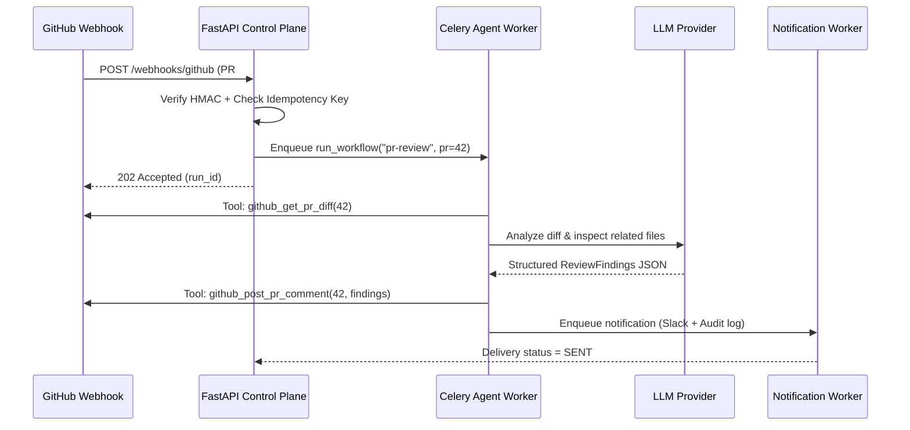

# 02 — Flagship Developer Workflows & End-to-End Use Cases

This document defines the **5 flagship autonomous developer workflows** that `runlatch` supports out of the box. Each workflow demonstrates multi-step orchestration, tool calling, guardrails, and (where applicable) asynchronous notifications + Human-in-the-Loop (HITL) approval.

---

## Workflow 1: Autonomous PR Review & Risk Analyzer (`pr-review`)

**Trigger:** GitHub `pull_request` webhook (`opened`, `synchronize`) or CLI `runlatch run pr-review --pr 42`.

### Multi-Step Pipeline
1. **Step 1 — Context Gatherer (`READ` only, auto-approved):**
   - Calls `github_get_pr_diff`, `github_get_pr_metadata`, and `read_file` for surrounding context of modified files.
   - Outputs structured `PRContext` (changed files, diff size, languages, sensitive paths touched like `auth/`, `migrations/`, `.github/`).
2. **Step 2 — Static & Security Reviewer (`READ` only):**
   - Inspects diff for bugs, N+1 queries, missing input validation, hardcoded secrets, and breaking API changes.
   - Outputs structured `ReviewFindings` (severity: `critical | warning | suggestion`, file, line, rationale, suggested fix).
3. **Step 3 — Action & Notification (`EXTERNAL`):**
   - If `critical` findings exist: posts a structured GitHub PR review comment AND sends a Slack/Discord alert to `#eng-reviews`.
   - Budget cap: `$0.15` per PR, max 8 tool calls.

---

## Workflow 2: CI Failure Root-Cause Triage (`ci-triage`)

**Trigger:** GitHub `workflow_run` webhook (`conclusion == "failure"`) or CLI.

### Multi-Step Pipeline
1. **Step 1 — Log Extractor (`READ`):**
   - Fetches failed job logs via `github_get_workflow_logs`, strips ANSI noise, isolates the failing stack trace or assertion error.
2. **Step 2 — Codebase Investigator (`READ`):**
   - Uses `git_log` (recent commits on the branch) and `read_file` on the failing test + implementation files to correlate what changed vs. what broke.
3. **Step 3 — Diagnosis & Fix Proposal (`READ` $\to$ `EXTERNAL`):**
   - Classifies failure as `code_regression`, `flaky_test`, `dependency_issue`, or `infra_timeout`.
   - Posts a concise root-cause summary + proposed patch diff to the PR and notifies the PR author via Slack/Discord.

---

## Workflow 3: Issue-to-PR Autonomous Patcher with HITL Gate (`issue-to-pr`)

**Trigger:** GitHub `issues` webhook when label `runlatch:fix` is applied, or CLI `runlatch run issue-to-pr --issue 108`.

### Multi-Step Pipeline (Demonstrating Stateless Worktree Pause & Resume!)
1. **Step 1 — Planner (`READ`):**
   - Reads issue body, searches repository (`search_code`, `read_file`), and produces a structured `ImplementationPlan` (files to edit, test strategy, risks).
2. **Step 2 — Coder & Verifier (`WRITE` + `EXEC` in an isolated `git worktree`):**
   - Checks out `base_commit_sha` into an ephemeral `git worktree` on branch `runlatch/issue-108`.
   - Applies targeted `SEARCH/REPLACE` edits (`edit_file`).
   - Runs targeted tests via `CommandExecutor` (`SubprocessExecutor` locally or `DockerSandboxExecutor` in prod). If tests fail, feeds stdout back into the ReAct loop (up to 3 fix attempts).
3. **Step 3 — Stateless Human Approval Gate (`PAUSE` before `EXTERNAL`):**
   - Before pushing the branch or opening a PR (`git_push` / `github_create_pr` are marked `RiskTier.EXTERNAL`), the Policy Engine intercepts the tool call.
   - Worker runs `git add -N .` (intent-to-add so brand-new untracked files like new tests are included!) before capturing `git diff HEAD` into `workflow_runs.workspace_patch` (capped at `512 KB`, excluding binaries) alongside `workspace_meta` (`repo_url`, `base_commit_sha`, `branch_name`, `test_summary`), saves conversation + workflow checkpoints to Postgres, and cleans up the ephemeral worktree.
   - Execution pauses (`WAITING_APPROVAL`) and frees the worker slot immediately.
   - Notification Engine dispatches an alert to the maintainer with a signed link to the **read-only HTMX Confirmation Page** (`/ui/approvals/{id}?sig=...&exp=...`) displaying the diff, passing test output, and cost (`$0.08`).
4. **Step 4 — Stateless Resume & Publish (`EXTERNAL`):**
   - Maintainer clicks **Approve & Open PR** on the confirmation page (submitting a `POST` with Postgres `SELECT ... FOR UPDATE` lock) or runs `runlatch approve <id>`.
   - *Any* healthy Celery worker picks up `resume_workflow_task`, clones/fetches `base_commit_sha` into a fresh `git worktree`, re-applies `workspace_patch` via `git apply --3way`, commits, executes `git_push` + `github_create_pr`, and marks the run `COMPLETED`.

---

## Workflow 4: Dependency & Security Audit (`dep-audit`)

**Trigger:** Scheduled weekly via **Celery Beat** (`0 9 * * 1` — Mondays at 9:00 AM).

### Multi-Step Pipeline
1. Scans `pyproject.toml`, `requirements.txt`, or `package.json` and runs read-only audit tools (`pip-audit` / `npm audit --json`).
2. Filters out false positives by checking whether vulnerable functions are actually imported/called in the codebase (`search_code`).
3. Generates an executive severity digest and dispatches it via the Notification Engine (Email + Slack).

---

## Workflow 5: Documentation & API Drift Sync (`doc-sync`)

**Trigger:** Push to `main` branch touching `app/api/` or `runlatch/`.

### Multi-Step Pipeline
1. Reads the git diff of API routes / public Python signatures.
2. Compares against `README.md` and `docs/`.
3. If public interfaces changed without matching doc updates, drafts a doc-update patch and triggers an approval notification to open a cleanup PR.

---

## Summary Matrix of Framework Capabilities Exercised

| Capability | `pr-review` | `ci-triage` | `issue-to-pr` | `dep-audit` | `doc-sync` |
|---|:---:|:---:|:---:|:---:|:---:|
| Multi-Step `Workflow` | Yes | Yes | Yes | Yes | Yes |
| Native Tool Calling | Yes | Yes | Yes | Yes | Yes |
| GitHub Webhooks | Yes | Yes | Yes | — | Yes |
| Celery Async Worker | Yes | Yes | Yes | Yes | Yes |
| Celery Beat Schedule | — | — | — | Yes | — |
| HITL Pause & Resume | — | — | **Yes** | — | **Yes** |
| Notification Engine | Yes | Yes | Yes | Yes | Yes |
| Budget & Loop Guards | Yes | Yes | Yes | Yes | Yes |
